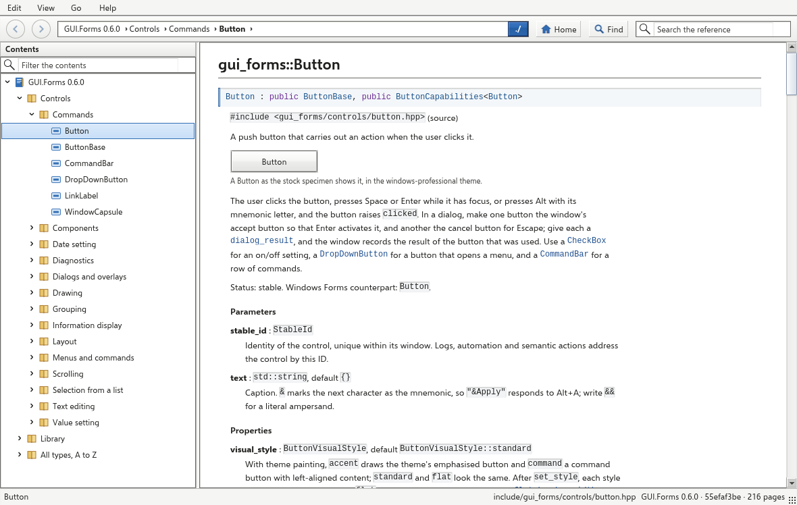

# Pocket Reference

Pocket Reference is GUI.Forms' API reference as a desktop program. It reads
one file, `reference.pack`, made at build time from GUI.Forms' generated
docs: a page for every control and type, with a contents tree, links, search,
find in page and back and forward. Each control's page shows that control as
GUI.Forms draws it, rendered from its stock specimen when the pack is built.

It is built with GUI.Forms, so it is also a small example of a GUI.Forms
program: its window and panes are forms (`forms/`), its look is a theme
package (`themes/pocket_reference`), and the page view is a control of its
own (`src/reference_page.cpp`).



## Download

Builds for macOS, Windows and Linux are attached to each
[release](https://github.com/malkuth-software/pocket_reference/releases).

## Building

Pocket Reference needs GUI.Forms 0.6 and LLVM 22. Either point CMake at an
installed GUI.Forms SDK:

```sh
cmake -S . -B build -G Ninja -DCMAKE_PREFIX_PATH=<sdk> \
  -DCMAKE_TOOLCHAIN_FILE=<sdk>/lib/cmake/GUIForms/llvm22.cmake \
  -DPOCKET_REFERENCE_DOCS=<GUI.Forms checkout>
cmake --build build --target pocket-reference
```

or build GUI.Forms from the pinned source, which is also where the docs come
from:

```sh
python3 scripts/fetch-gui-forms.py
cmake -S . -B build -G Ninja -DCMAKE_TOOLCHAIN_FILE=gui_forms/cmake/llvm22.cmake \
  -DPOCKET_REFERENCE_TOOLKIT_SOURCE_DIR=$PWD/gui_forms
cmake --build build --target pocket-reference
```

The pin is in `third_party/gui-forms.lock.json`. `tools/package.py` makes the
download for the host it runs on.

## Licence

PolyForm Noncommercial 1.0.0; see `LICENSE`. The pack coder in `pack_coder/`
is copied from Pocket Library.
